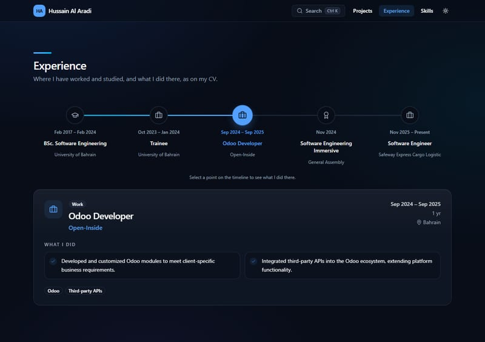
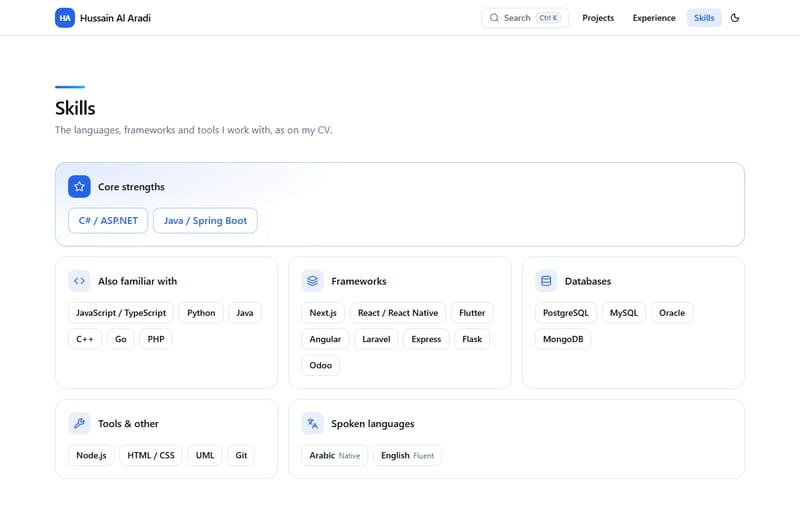
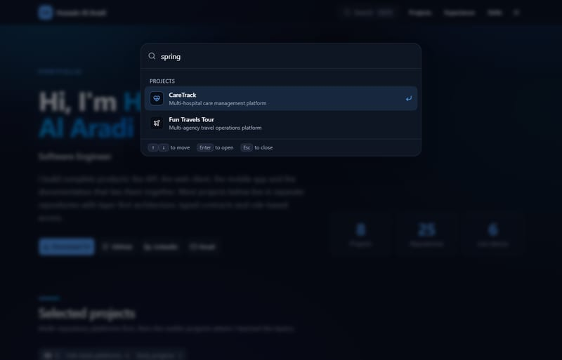
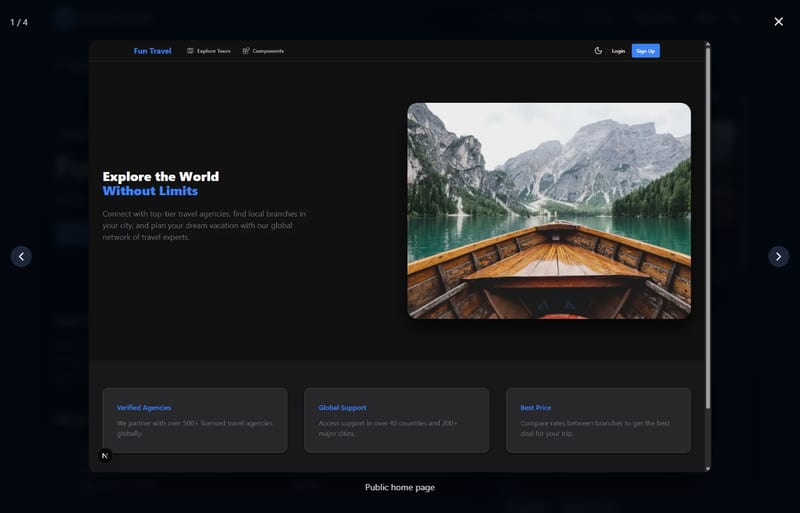

# Portfolio

Personal portfolio of **Hussain Al Aradi**, Software Engineer. It shows nine projects with screenshots, tech stacks, repositories and live demos, my experience and skills as they appear on my CV, and a downloadable CV. Built with **Angular 21**, **Spartan UI** (helm components on `@spartan-ng/brain`) and **Tailwind CSS 4**, in light and dark themes.

**Live:** https://hussainalaradi5.github.io/portfolio/


## What's on the site

| Page | What it shows |
| --- | --- |
| **Home** (`/`) | Everything at once: the hero (Download CV, GitHub, LinkedIn, Email and project totals), projects, experience and skills |
| **Projects** (`/projects`) | Project cards with Full-stack platforms and Early projects filters |
| **Project page** (`/projects/<slug>`) | Overview, what it does, tech stack by layer, repositories, live links and a screenshot gallery that opens full screen |
| **Experience** (`/experience`) | A horizontal timeline of work, education and certificates; selecting a stop shows what I did there, the dates and the length |
| **Skills** (`/skills`) | The CV's skills in groups, core strengths first |

Also on every page:

- **Search** with **Ctrl + K** (**⌘ K** on a Mac) or the header button: pages, projects (matched by name, domain and technologies) and actions such as Download CV and switching the theme.
- **Light and dark themes**, following the system setting until you choose one.
- **Motion** (hero entrance, card reveal, timeline fill) that turns off under the system's reduce-motion setting.
- **Link previews**: shared links show a card with my name, title and core stack on LinkedIn, WhatsApp, X and Slack.
- Every action appears once: CV, GitHub, LinkedIn and Email live in the hero, and the header only navigates.

## Screenshots

| Projects (dark) | Project page |
| --- | --- |
|  |  |

| Experience timeline | Skills |
| --- | --- |
|  |  |

| Ctrl + K search | Screenshot lightbox |
| --- | --- |
|  |  |

<p align="center"></p>

## Projects

| Project | Stack | Status |
| --- | --- | --- |
| CareTrack | Spring Boot 4, Angular 21, Flutter, PostgreSQL, Keycloak | In progress |
| e-Clinic | Laravel 12, Angular 21, Flutter, PostgreSQL, Redis | Live demo, Android APK |
| Fun Travels Tour | Spring Boot 3.5, Next.js 16, Expo, PostgreSQL | Live demo, Android APK |
| Books Build Minds | Flask, Next.js 16, Flutter, PostgreSQL | Completed |
| TaskFlow | Express 5, Angular 21, MongoDB | Live demo |
| Videos Waves | Express 5, Next.js 16, Flutter, MongoDB | Live demo, Android APK |
| Studium | PHP 8.2, MySQL, vanilla JavaScript, Leaflet | Live demo |
| Fantasy Cards | React | Live demo |
| Duck Street | JavaScript, HTML, CSS | Live demo |

## Run locally

```bash
npm ci
npm start                    # http://localhost:4200
npm test -- --watch=false    # unit tests (Vitest)
npm run build                # output: dist/portfolio/browser
npm run images:optimize      # new PNG/JPG project screenshots to WebP + thumbnails
npm run screenshots          # README screenshots in docs/screenshots (starts and stops its own server)
npm run og:render            # link-preview card: public/og-image.png
npm run icons:favicon        # public/favicon.ico from public/favicon.svg
```

`screenshots`, `og:render` and `icons:favicon` use Microsoft Edge in headless mode; set `BROWSER` to another Chromium-based browser if needed. `npm run screenshots` starts the site on port 4321 and stops it when done (about 30 seconds); set `BASE_URL` to capture a server that is already running instead.

## Layout (layer-first)

```text
src/app/
├── config/site/            owner profile, CV file and social links
├── constants/
│   ├── common/             UI text
│   ├── projects/           project data (one file per project in data/), labels, filters, display limits
│   ├── experience/         timeline entries from the CV, kind labels and icons, period words
│   ├── skills/             skill groups from the CV
│   ├── command-palette/    group labels and the Ctrl/⌘ + K shortcut
│   ├── routes/             route paths and page titles
│   └── ui/                 icons, keyboard keys, swipe threshold, theme keys, progress bar timing
├── enums/                  projects, experience (kind), command-palette (group), ui (theme)
├── types/ui/               AppIconName (icon names checked at build time)
├── interfaces/             projects, experience, skills, command-palette, home, site (one per file)
├── services/               projects/project, site/cv-download, ui/{theme,route-progress,command-palette}
├── middlewares/            guards/projects (unknown slugs go to 404), resolvers/projects (tab titles)
├── utilities/              projects, experience/period, command-palette/{filter,shortcut}, routes/page-title, images/thumbnail
├── components/
│   ├── layout/             header, footer, route progress bar, command palette
│   ├── common/             section heading, CV download button, image lightbox
│   ├── home/               hero
│   ├── projects/           projects section, card, cover, gallery, tech groups, repository list
│   ├── experience/         timeline, details card
│   └── skills/             skills section
└── pages/                  home, projects (list and detail), experience, skills, system (404)
libs/ui/                    Spartan helm components (button, card, badge, separator, tabs, tooltip, progress)
public/
├── files/cv/               the CV behind Download CV
├── images/projects/        screenshots per project: <name>.webp and <name>.thumb.webp
└── og-image.png, favicon.*, apple-touch-icon.png
scripts/                    images (optimizer), screenshots (README), og (preview card), icons (favicon.ico)
docs/screenshots/           README screenshots
phases/                     project phases with status and verification
```

Each utility, service and interactive component has a spec next to it.

### Add or change a project

1. Add PNG or JPG screenshots under `public/images/projects/<slug>/` and run `npm run images:optimize`.
2. Create `src/app/constants/projects/data/<slug>.constants.ts` following an existing file; point screenshots at the `.webp` files.
3. Add it to `PROJECTS` in `src/app/constants/projects/projects.constants.ts` (array order is display order). It appears in search automatically.
4. If it uses a new Lucide icon, register it in `APP_ICONS` in `src/app/constants/ui/icons.constants.ts`; an unregistered name fails the build.

Repository links are built from the repository name. Mark private repositories with `isPrivate: true`; they show "Private repository" instead of a link.

### Update the CV

The site follows the CV, so change them together:

1. Replace `public/files/cv/hussain-al-aradi-cv.pdf`.
2. Copy any changed roles, dates or lines into `src/app/constants/experience/experience.constants.ts` (lengths are worked out from the dates).
3. Copy any changed skills into `src/app/constants/skills/skills.constants.ts`.

## Deploy

### GitHub Pages (live site)

Live at **https://hussainalaradi5.github.io/portfolio/**.

`.github/workflows/deploy.yml` runs on every push to `master` (or by hand from the Actions tab): it installs, runs the unit tests, builds with `--base-href /portfolio/`, copies `index.html` to `404.html` so deep links such as `/portfolio/experience` load the app, and deploys to Pages. A failing test stops the deploy.

One-time setup: **Settings → Pages → Build and deployment → Source: GitHub Actions**.

Shared links are cached by LinkedIn and WhatsApp; after changing the preview card, refresh it in LinkedIn's Post Inspector.

### Render (alternative)

`render.yaml` describes a Render static site at the domain root: it runs `npm ci && npm run build`, serves `dist/portfolio/browser`, and rewrites every path to `index.html`. In the Render dashboard choose **New → Blueprint** and connect this repository; each push to `master` redeploys.
