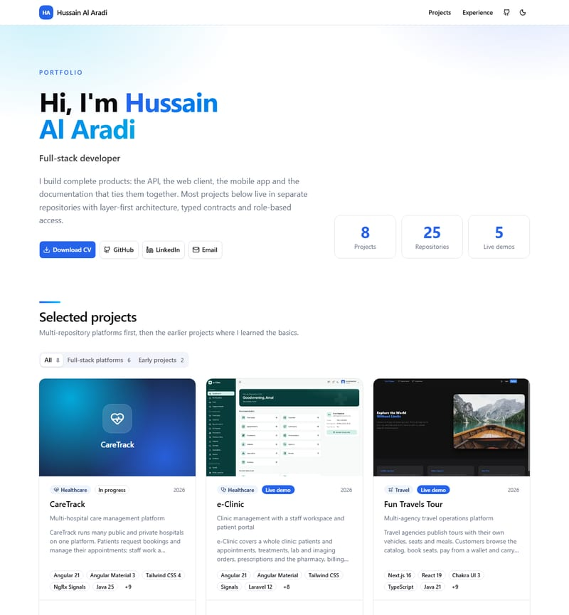
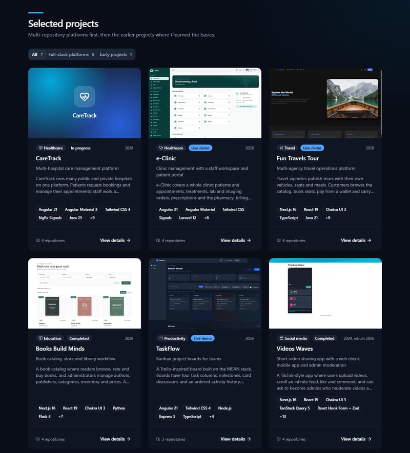
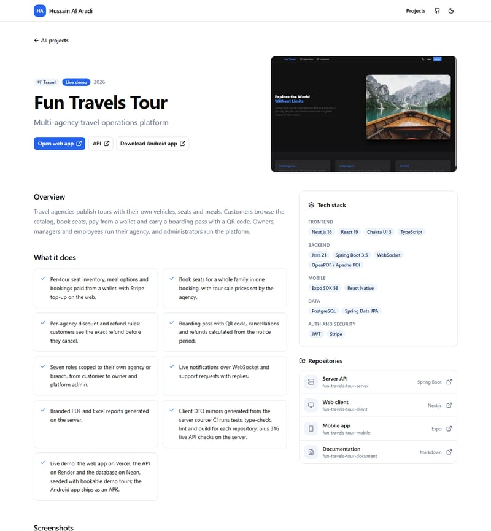
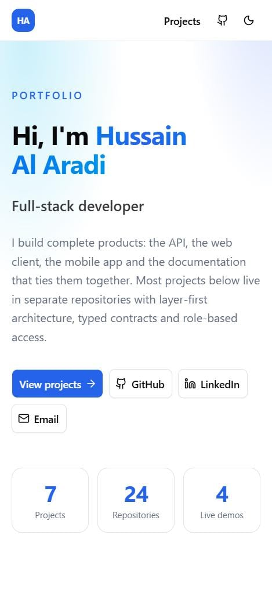

# Portfolio

Personal portfolio of Hussain Al Aradi, built with **Angular 21**, **Spartan UI** (helm components on `@spartan-ng/brain`) and **Tailwind CSS 4**. It presents seven projects with screenshots, tech stack, repositories and live demo links, in light and dark themes.

**Live:** https://hussainalaradi5.github.io/portfolio/

## Screenshots

| Home (light) | Projects (dark) |
| --- | --- |
|  |  |

| Project page | Phone (375px) |
| --- | --- |
|  |  |

| Project | Stack |
| --- | --- |
| CareTrack | Spring Boot 4, Angular 21, Flutter, PostgreSQL, Keycloak |
| e-Clinic | Laravel 12, Angular 21, Flutter, PostgreSQL, Redis |
| Fun Travels Tour | Spring Boot 3.5, Next.js 16, Expo, PostgreSQL |
| Books Build Minds | Flask, Next.js 16, Flutter, PostgreSQL |
| TaskFlow | Express 5, Angular 21, MongoDB |
| Videos Waves | Express 5, Next.js 16, Flutter, MongoDB |
| Fantasy Cards | React |

## Run locally

```bash
npm ci
npm start          # http://localhost:4200
npm test -- --watch=false
npm run build      # output: dist/portfolio/browser
npm run images:optimize   # convert new PNG/JPG screenshots to WebP + thumbnails
```

## Layout (layer-first)

```text
src/app/
├── config/site/            owner profile and social links
├── constants/
│   ├── common/             UI text
│   ├── projects/           project data (one file per project in data/), labels, filters, display limits
│   ├── routes/             route paths
│   └── ui/                 icons, theme keys, progress bar timing
├── enums/                  projects (tier, status, repository role, tech layer), ui (theme)
├── types/ui/               AppIconName (icon names checked at build time)
├── interfaces/             home, projects, site (one per file)
├── services/               projects/project (ProjectService), ui/theme, ui/route-progress
├── middlewares/guards/     projects (unknown slugs go to 404)
├── utilities/              projects/{filter,tech,neighbours,stats,repositories}, images/thumbnail (one function per file, each with a spec)
├── components/             layout (header, footer, progress bar), common, home, projects
└── pages/                  home, projects (detail), system (404)
libs/ui/                    Spartan helm components (button, card, badge, separator, tabs, tooltip, progress)
public/images/projects/     screenshots per project: <name>.webp and <name>.thumb.webp
scripts/images/             image optimizer
phases/                     project phases with status and verification
```

### Add or change a project

1. Add PNG or JPG screenshots under `public/images/projects/<slug>/` and run `npm run images:optimize`.
2. Create `src/app/constants/projects/data/<slug>.constants.ts` following an existing file; point screenshots at the `.webp` files.
3. Add it to `PROJECTS` in `src/app/constants/projects/projects.constants.ts` (array order is display order).
4. If it uses a new Lucide icon, register it in `APP_ICONS` in `src/app/constants/ui/icons.constants.ts`; an unregistered name fails the build.

Repository links are built from the repository name. Mark private repositories with `isPrivate: true`; they show "Private repository" instead of a link.

## Deploy

### GitHub Pages (live site)

Live at **https://hussainalaradi5.github.io/portfolio/**.

`.github/workflows/deploy.yml` runs on every push to `master` (or by hand from the Actions tab): it installs, runs the unit tests, builds with `--base-href /portfolio/`, copies `index.html` to `404.html` so deep links load the app, and deploys to Pages. A failing test stops the deploy.

One-time setup: **Settings → Pages → Build and deployment → Source: GitHub Actions**.

### Render (alternative)

`render.yaml` describes a Render static site at the domain root: it runs `npm ci && npm run build`, serves `dist/portfolio/browser`, and rewrites every path to `index.html`. In the Render dashboard choose **New → Blueprint** and connect this repository; each push to `master` redeploys.
